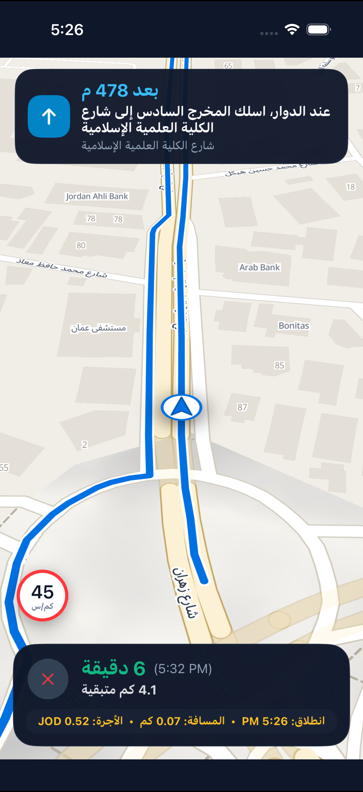
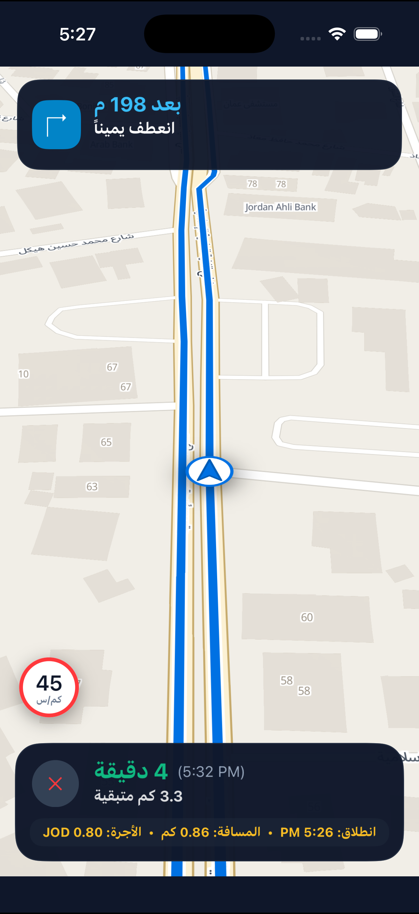

# Siro Nav for Flutter
### Turn-by-Turn In-App Navigation SDK for Flutter (Flutter 3.x • iOS & Android)

[](https://flutter.dev)
[](https://dart.dev)
[](https://opensource.org/licenses/MIT)
[](https://map.intaleqapp.com)

A production-grade, in-app turn-by-turn navigation SDK engineered for ride-hailing, courier delivery, and logistics applications across the MENA region. Drivers remain completely within your application—eliminating external map app dispatch (Google Maps, Waze) while reducing platform operating map licensing costs by up to 80% ($0.30+ per ride).

---

## 📸 Live Visuals & HUD Architecture

<div align="center">
  
  &nbsp;&nbsp;&nbsp;&nbsp;
  
</div>

- **Road-Adherent Blue Polyline**: Dual-layered navigation polyline with high-contrast halo casing (`12px`) and core route stroke (`7.5px`) mapped precisely to actual road geometry, roundabouts, and intersections.
- **Intelligent Roundabout Voice Guidance**: Automatically resolves rotary maneuvers to specific exit numbers (`Exit 1..6`) mapped directly to offline studio voice prompts and localized Arabic street names.
- **Dynamic 3D Chase Camera**: Real-time heading synchronization with smart velocity-adaptive zoom (`18.8x` low speed, `18.0x` mid-range, `16.8x` highway speed).
- **Embedded Trip & Meter Tariff Engine**: Real-time tracking of distance traveled, waiting minutes under speed thresholds (<5 km/h), and dynamic cumulative fare calculation in any developer-selected currency (`JOD`, `SAR`, `AED`, `USD`).
- **Elevated Speedometer Widget**: Prominent floating speed gauge with high-visibility speed threshold ring indicators.

---

## 📦 Installation

Add `siro_nav` to your `pubspec.yaml`:

```yaml
dependencies:
  siro_nav:
    git:
      url: https://github.com/Hamza-Ayed/siro-nav-flutter.git
      path: packages/siro_nav
```

Then execute:
```bash
flutter pub get
```

---

## ⚡ Quick Start (5 Lines of Code)

### 1. Initialize Controller & Define Developer Tariff Rules

```dart
import 'package:flutter/material.dart';
import 'package:siro_nav/siro_nav.dart';

// 1. Initialize controller with your Siro API key
final nav = await SiroNavController.create(
  config: NavConfig(apiKey: 'YOUR_SIRO_API_KEY'),
);

// 2. Configure fare calculation metrics & custom currency
final fareConfig = NavFareConfig(
  baseFare: 0.50,            // Base initial starting fare
  perKilometer: 0.35,        // Rate per kilometer
  perWaitingMinute: 0.05,    // Rate per waiting minute (speed < 5 km/h)
  currency: 'JOD',           // Target currency: JOD, SAR, AED, USD
  waitingSpeedKmh: 5.0,
);

// 3. Initiate navigation to destination
await nav.startNavigation(
  destination: NavPoint(latitude: 31.9650, longitude: 35.8900),
  phase: NavTripPhase.trip,
  fare: fareConfig,
);
```

### 2. Render Drop-in Navigation View (`SiroNavView`)

```dart
@override
Widget build(BuildContext context) {
  return Scaffold(
    body: SiroNavView(
      controller: nav,
      locale: 'ar',                // Language: 'ar' or 'en'
      showFareMetrics: true,       // Display developer fare & distance telemetry
      onExit: () {
        nav.stopNavigation();
        Navigator.of(context).pop();
      },
    ),
  );
}
```

---

## 🎛️ Event Telemetry & Trip Totals

Listen to real-time navigation updates, rerouting events, and arrival totals:

```dart
nav.addListener((event) {
  if (event is NavProgressEvent) {
    print('Remaining Distance: ${event.distanceRemainingMeters} m');
    print('Current Fare: ${event.currentFare} ${fareConfig.currency}');
  } else if (event is NavArrivedEvent) {
    print('Trip Completed! Total Fare: ${event.totals.totalFare} ${fareConfig.currency}');
    print('Total Distance: ${event.totals.totalDistanceKm} km');
    print('Waiting Time: ${event.totals.waitingMinutes} min');
  }
});
```

---

## 🧪 Automated Testing

Execute unit and core engine tests:
```bash
cd packages/siro_nav_core && dart test
cd packages/siro_nav && flutter test
```

---

## 📄 License
MIT License. © 2026 Siro Maps & Hamza Ayed.
